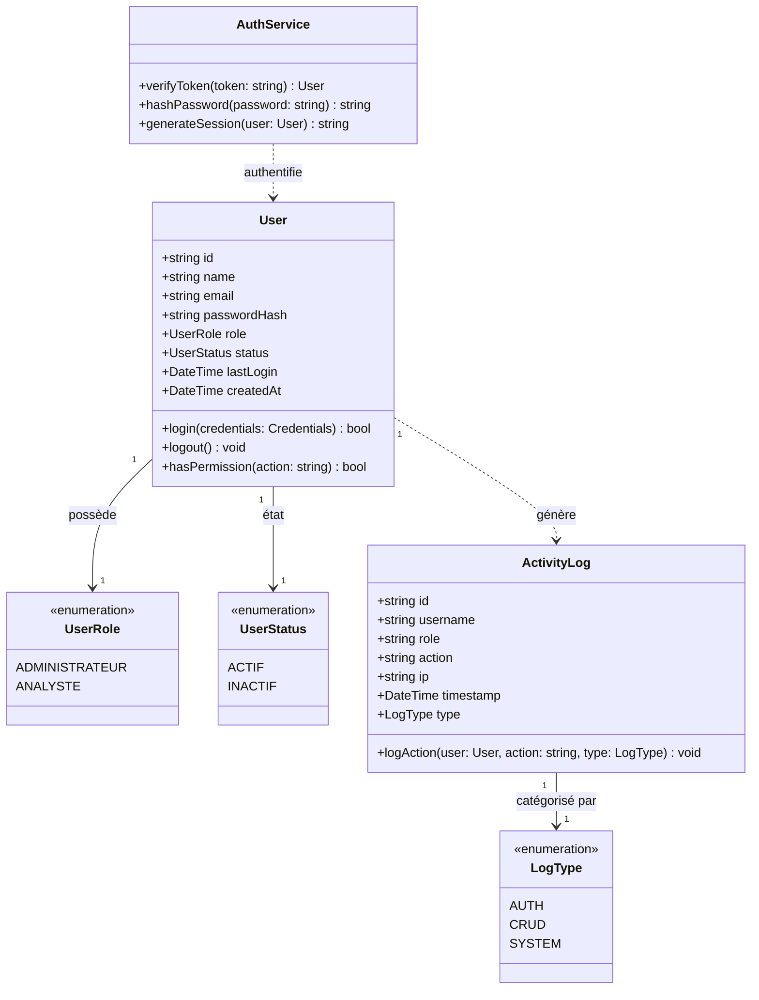
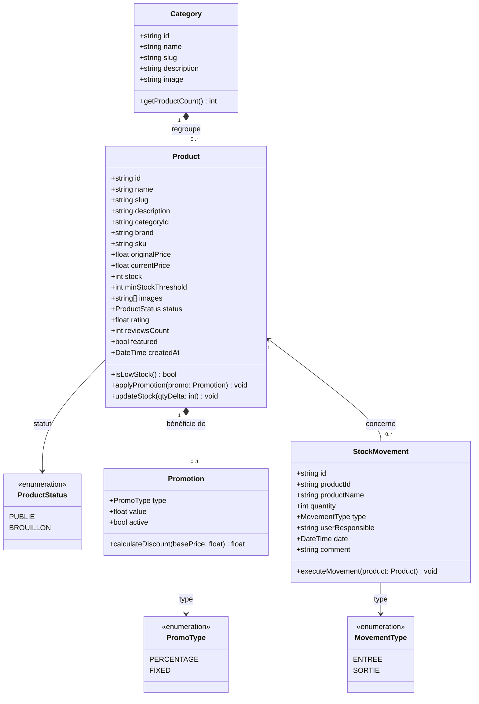
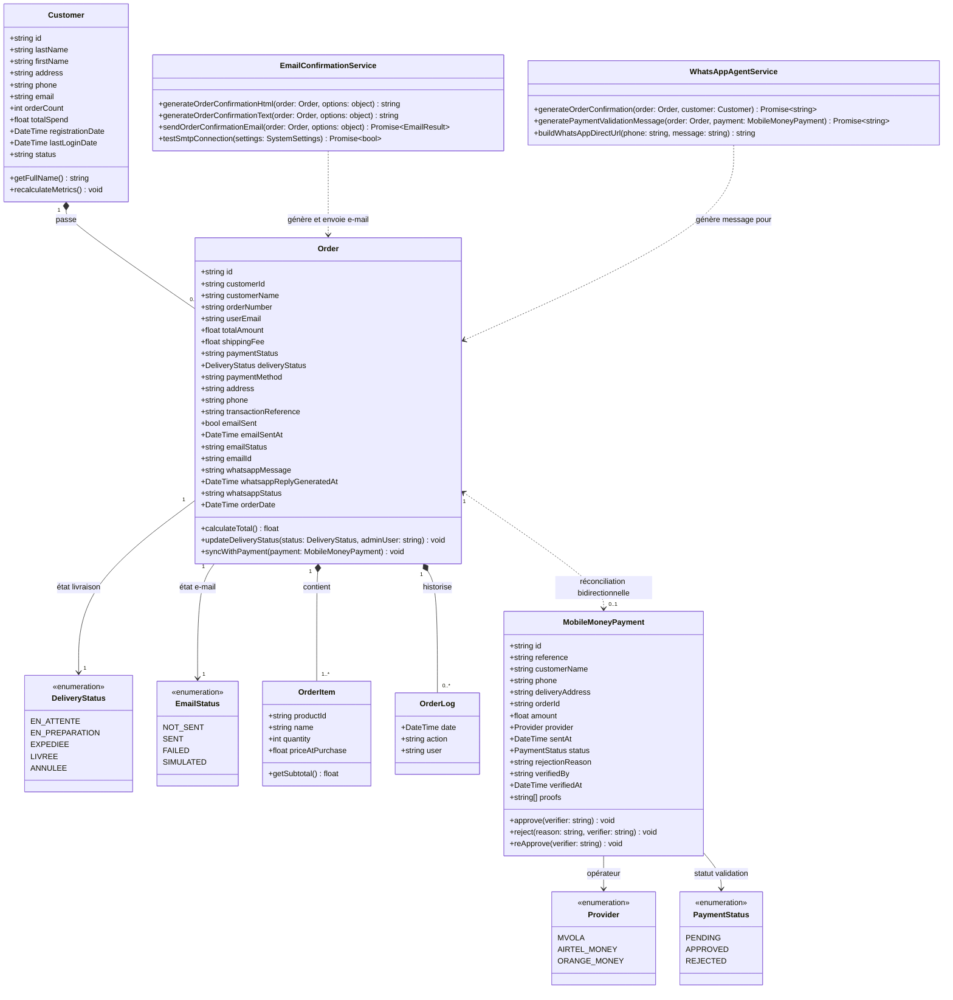
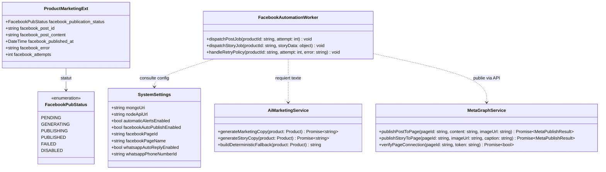
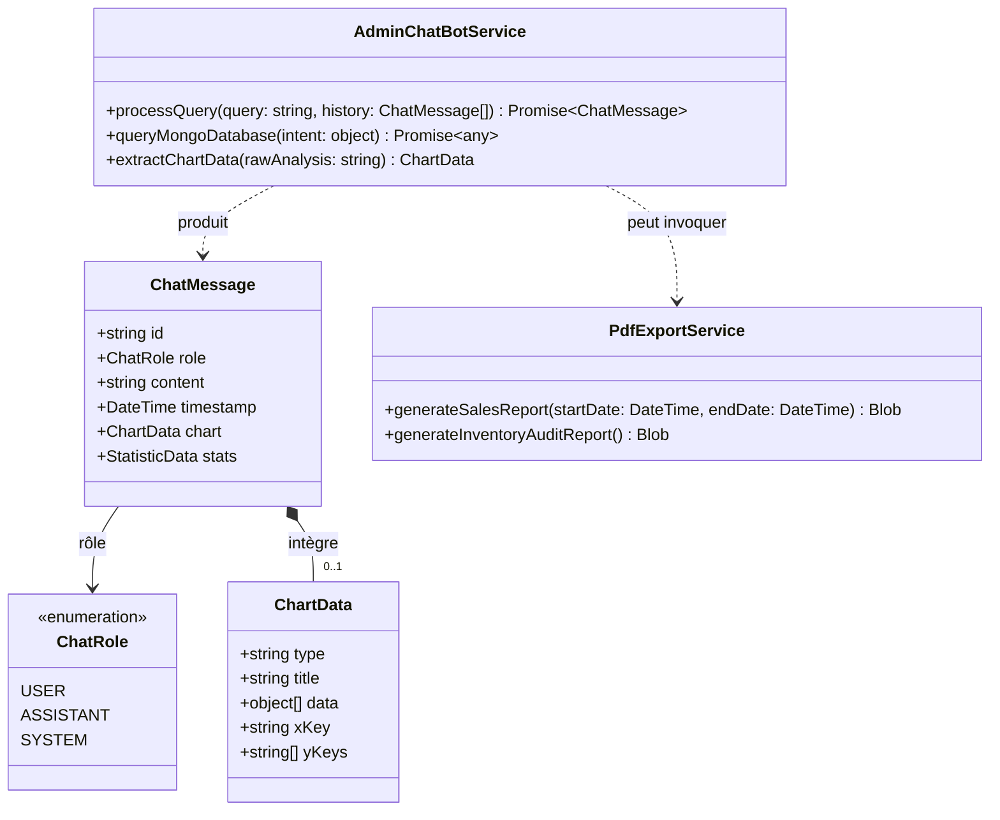
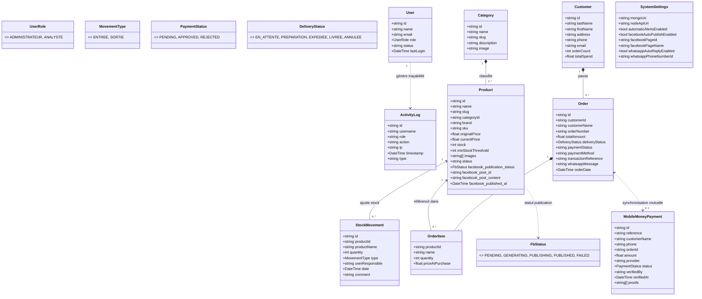
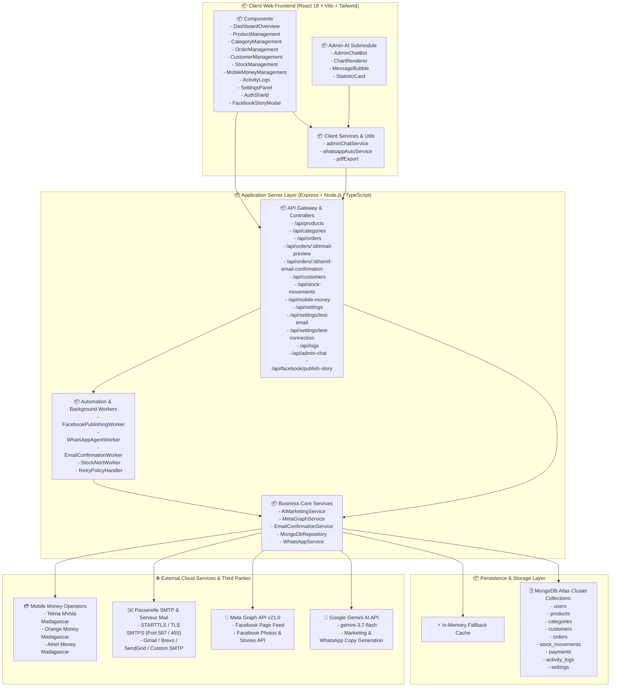
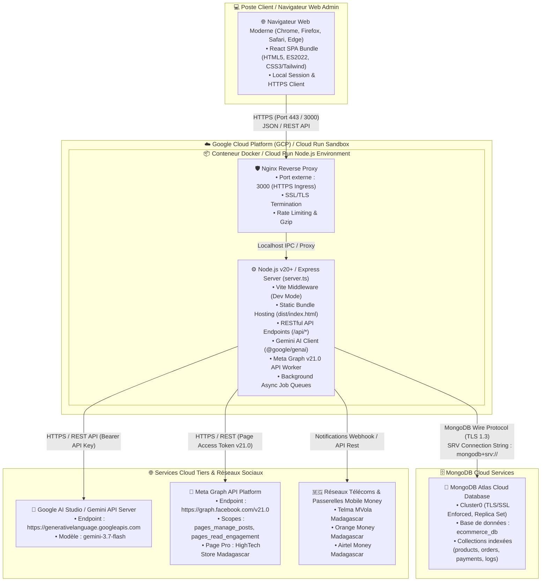

# 📐 Dossier de Conception Logicielle & Spécifications UML
## Projet : DataCommerce Dashboard & Plateforme E-Commerce Intelligente

---

## 📌 1. Présentation Générale du Projet

Le projet **DataCommerce Dashboard & HighTech Store Madagascar** est une plateforme intégrée d'administration et de gestion e-commerce moderne conçue pour le marché malgache et international. Elle unifie :
1. **Gestion Métier Complète :** Gestion des catalogues produits, catégories, clients, commandes et stocks (flux d'entrées/sorties).
2. **Paiements Locaux Sécurisés & Réconciliation Bidirectionnelle :** Validation, vérification des reçus et ré-approbation des paiements par Mobile Money (*MVola*, *Orange Money*, *Airtel Money*) synchronisés en temps réel avec les commandes.
3. **Réponse Automatique & Notifications E-mail Professionnelles :** Envoi automatique instantané d'e-mails de confirmation de commande responsive (HTML + Plain-Text), avec récapitulatif détaillé des articles, adresses, coordonnées du service client et diagnostic SMTP intégré.
4. **Agent IA Service Client WhatsApp :** Génération automatique de messages de suivi personnalisés et envoi via WhatsApp Web ou l'API Meta Cloud Business.
5. **Automatisation Marketing par IA (Posts & Stories) :** Rédaction publicitaire avec **Google Gemini AI** et publication en temps réel (Feed & Stories) sur la Page Facebook via **Meta Graph API v21.0**.
6. **Intelligence Décisionnelle & Assistant Admin IA :** Assistant conversationnel expert capable de requêter la base MongoDB et de générer des graphiques analytiques interactifs (Recharts / D3).
7. **Backend Polyglotte & Microservices :** Serveur Node.js/TypeScript (Express) principal et dépendances microservices Python (`requirements.txt`) pour le traitement de données, génération PDF et scripts IA.

---

## 🔄 2. Découpage par Sprints & Diagrammes de Classe

---

### 🔹 Sprint 1 : Authentification, RBAC & Journalisation d'Audit
*Objectifs :* Sécurisation des accès, gestion des profils (Administrateur, Analyste), contrôle d'accès basé sur les rôles (RBAC) et traçabilité complète des actions système et CRUD.



---

### 🔹 Sprint 2 : Gestion du Catalogue, Promos & Mouvements de Stock
*Objectifs :* Gestion hiérarchique des catégories, fiches produits riches (prix en Ariary, remises, SKU, images multiples, seuil d'alerte) et traçabilité des flux de stock (Entrées/Sorties).



---

### 🔹 Sprint 3 : Clients, Commandes, Paiements Mobile Money, E-mail & WhatsApp IA
*Objectifs :* Cycle de vie des clients, enregistrement des commandes, réconciliation financière bidirectionnelle Mobile Money (*MVola*, *Airtel Money*, *Orange Money*), notification automatique par e-mail professionnel responsive (HTML/Plain Text) et agent IA de notification client WhatsApp.



---

### 🔹 Sprint 4 : Marketing IA, Stories & Automatisation Meta Graph API
*Objectifs :* Pipeline asynchrone non-bloquant : génération automatisée de textes de vente optimisés via Google Gemini AI et publication sur la Page Facebook pro (Posts & Stories) via Meta Graph API v21.0 avec gestion des réessais.



---

### 🔹 Sprint 5 : Analytics Décisionnels & Assistant Conversationnel Admin IA
*Objectifs :* Moteur d'analyse prédictive des ventes, KPI en temps réel, export de rapports PDF certifiés et assistant conversationnel avec génération de graphiques interactifs.



---

## 🌐 3. Diagramme de Classe Global Consolidé

Ce diagramme unifie l'ensemble des modules métiers, d'authentification, de paiement, de logistique, d'agent WhatsApp, d'automatisation IA et de décisionnel.



---

## 📦 4. Diagramme de Paquetage (Package Diagram)

L'architecture est organisée selon les principes de la **Clean Architecture** et du découpage modulaire full-stack.



---

## 🚀 5. Diagramme de Déploiement (Deployment Diagram)

Ce diagramme décrit l'infrastructure physique et conteneurisée sur **Google Cloud Platform (Cloud Run)**, les passerelles réseaux sécurisées et les services SaaS tiers.



---

## 📋 6. Matrice de Traçabilité des Exigences & Entités Métier

| Module / Sprint | Entités Clés | Rôles Autorisés | Points d'Entrée API |
| :--- | :--- | :--- | :--- |
| **Sprint 1 : Sécurité** | `User`, `ActivityLog`, `SystemSettings` | Administrateur | `POST /api/login`, `GET /api/logs`, `POST /api/settings`, `POST /api/settings/test-connection` |
| **Sprint 2 : Catalogue** | `Product`, `Category`, `StockMovement` | Admin, Analyste | `GET/POST/PUT/DELETE /api/products`, `/api/categories`, `/api/stock-movements` |
| **Sprint 3 : Commercial, E-mail & Mobile Money** | `Customer`, `Order`, `MobileMoneyPayment`, `EmailConfirmation` | Admin, Analyste | `GET/POST/PUT /api/orders`, `/api/orders/:id/email-preview`, `POST /api/orders/:id/send-email-confirmation`, `POST /api/settings/test-email`, `/api/customers`, `/api/mobile-money`, `/api/mobile-money/:id` (Validation/Rejet/Ré-approbation) |
| **Sprint 4 : Marketing IA & Stories** | `Product (FB fields)`, `AiMarketingService` | Admin (Automate) | `POST /api/products/:id/facebook-publish`, `POST /api/facebook/publish-story`, Meta Graph v21.0 |
| **Sprint 5 : Décisionnel & WhatsApp** | `ChatMessage`, `ChartData`, `PdfExport`, `WhatsAppAgent` | Admin, Analyste | `POST /api/admin-chat`, Moteur décisionnel D3 / Recharts, WhatsApp Web Direct |

---

## 🐍 7. Dépendances & Microservices Python (`requirements.txt`)

Pour les scripts de traitement de données par lots, d'analyses prédictives et d'invoicing automatisé, l'environnement inclut le fichier `requirements.txt` :

```txt
# Google Gemini & GenAI SDK
google-genai>=1.0.0
google-generativeai>=0.8.0

# Base de Données NoSQL
pymongo>=4.9.0
motor>=3.6.0

# Frameworks Web & API (FastAPI / Flask)
fastapi>=0.115.0
uvicorn[standard]>=0.32.0
flask>=3.1.0
flask-cors>=5.0.0

# Requêtes HTTP & Intégrations (Meta Graph API / WhatsApp / Mail)
requests>=2.32.3
httpx>=0.28.0
aiohttp>=3.11.0

# Configuration & Traitement de Données
python-dotenv>=1.0.1
pydantic>=2.10.0
pandas>=2.2.3
pillow>=11.0.0
reportlab>=4.2.5
```

---

## 🔒 8. Sécurité & Bonnes Pratiques

1. **Isolation des Secrets :** Les clés sensibles (`GEMINI_API_KEY`, `META_PAGE_ACCESS_TOKEN`, `MONGODB_URI`, `SMTP_PASS`) résident exclusivement côté serveur (`process.env` ou paramètres sécurisés) et ne sont jamais exposées au navigateur.
2. **Réconciliation Transactionnelle :** Synchronisation atomique entre les tables `orders` et `payments` (approbation, rejet, ré-approbation et mise à jour du chiffre d'affaires client).
3. **Idempotence des Tâches :** Protection contre les doubles envois d'e-mails de confirmation (`order.emailSent`), doubles publications Facebook et doubles validations Mobile Money.
4. **Tolérance aux Pannes & Mode Dégradé :** Fallback en mémoire dynamique si MongoDB Atlas ou les serveurs SMTP externes sont temporairement inaccessibles (simulation console traçable).
