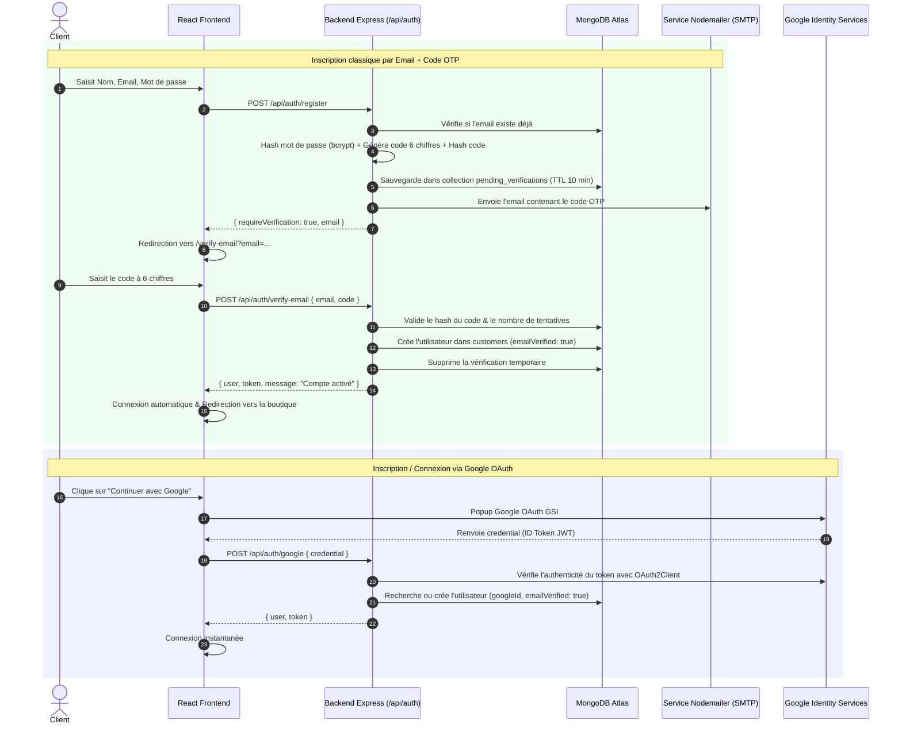
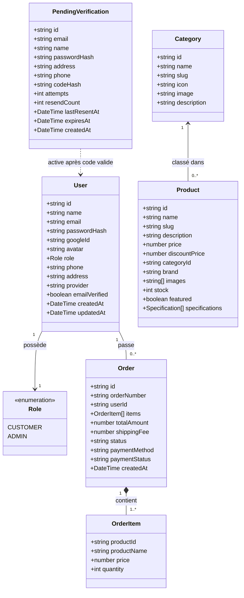
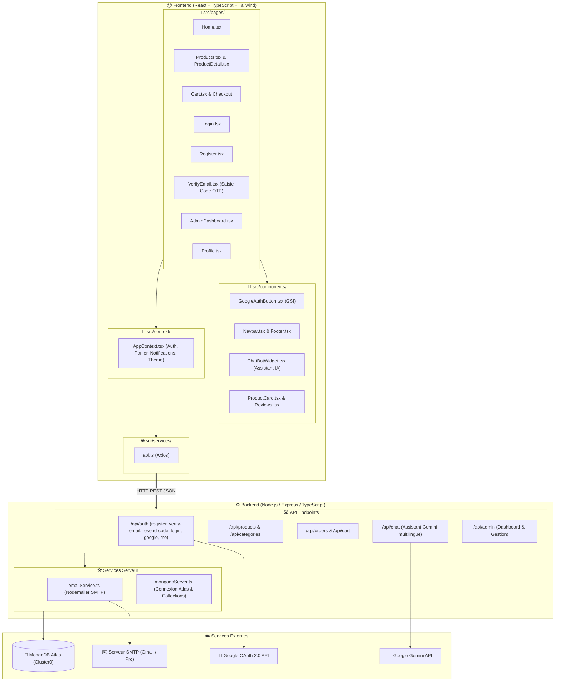
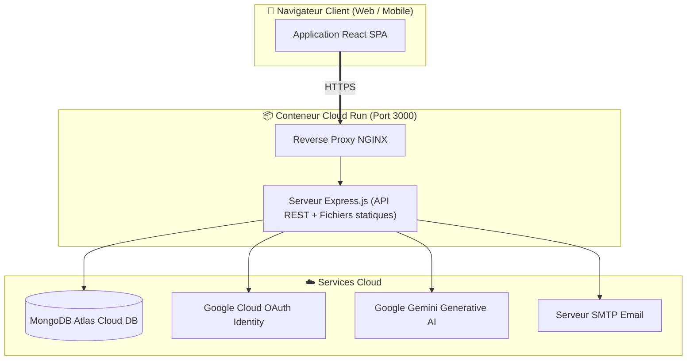

# 🛍️ Vahaolana Mora - Plateforme E-Commerce Pro & Assistant IA

Bienvenue dans le document de référence, de conception et d'utilisation du projet **Vahaolana Mora**, une plateforme e-commerce moderne, sécurisée et modulaire développée en **React 18, TypeScript, Tailwind CSS, Node.js / Express et MongoDB Atlas**, intégrant un assistant conversationnel intelligent multilingue (Français, Malagasy, Anglais) propulsé par Google Gemini.

---

## 📑 Table des Matières

1. [✨ Fonctionnalités Principales](#-fonctionnalités-principales)
2. [🔐 Système d'Authentification & Sécurité](#-système-dauthentification--sécurité)
   - [1. Inscription par Email avec Code de Vérification à 6 chiffres (OTP)](#1-inscription-par-email-avec-code-de-vérification-otp)
   - [2. Authentification Google OAuth 2.0 (Google Identity Services)](#2-authentification-google-oauth-20)
   - [3. Mesures de Sécurité & Protection](#3-mesures-de-sécurité--protection)
3. [📊 Architecture & Diagrammes de Conception](#-architecture--diagrammes-de-conception)
   - [Diagramme de Flux d'Authentification & Vérification](#diagramme-de-flux-dauthentification--vérification)
   - [Diagramme de Classes Global](#diagramme-de-classes-global)
   - [Diagramme d'Architecture & Paquetage](#diagramme-darchitecture--paquetage)
   - [Diagramme de Déploiement](#diagramme-de-déploiement)
4. [⚙️ Variables d'Environnement (.env)](#-variables-denvironnement-env)
5. [🚀 Guide d'Installation & Démarrage](#-guide-dinstallation--démarrage)
6. [🔧 Configuration des Services Externes](#-configuration-des-services-externes)
   - [A. Configuration Google Cloud Console (OAuth 2.0)](#a-configuration-google-cloud-console-oauth-20)
   - [B. Configuration SMTP Email (Gmail / Nodemailer)](#b-configuration-smtp-email-gmail--nodemailer)
   - [C. Base de données MongoDB Atlas](#c-base-de-données-mongodb-atlas)
7. [📁 Structure du Projet](#-structure-du-projet)

---

## ✨ Fonctionnalités Principales

### 🛒 E-Commerce & Expérience Client
- **Catalogue & Navigation :** Fiches produits détaillées avec zoom dynamique, galerie multimédia, spécifications techniques, gestion du stock en temps réel et badges (Nouveautés, Promotions, En vedette).
- **Recherche & Filtres :** Recherche plein texte instantanée, filtrage multi-critères (catégorie, gamme de prix, marque, disponibilité en stock) et tri avancé.
- **Panier Dynamique & Réductions :** Gestion d'articles, calcul automatique des sous-totaux, taxes et frais d'expédition, application de codes promo / coupons de réduction avec validation instantanée.
- **Tunnel de Commande Multi-Paiements :** Prise en charge des moyens de paiement locaux et internationaux :
  - **Mobile Money :** MVola, Orange Money, Airtel Money (avec validation de transaction et référence).
  - **Carte Bancaire :** Visa, Mastercard.
  - **Paiement à la Livraison :** Espèces à la réception.
- **Espace Client :** Historique des commandes avec statuts interactifs, téléchargement/visualisation des factures, gestion du profil et carnet d'adresses.
- **Avis & Notations :** Système d'évaluation produit avec commentaires et badge "Achat vérifié".

### 🤖 Assistant Virtuel IA Multilingue (Google Gemini)
- Support conversationnel fluide en **Français**, **Malagasy** et **Anglais**.
- Recommandations intelligentes de produits selon les besoins décrits par l'utilisateur.
- Réponse instantanée avec moteur de règles contextuelles de secours si l'API externe est indisponible.

### 🛡️ Espace d'Administration
- **Tableau de Bord Analytics :** Chiffre d'affaires, volume de ventes, alertes de stock faible, taux de conversion.
- **Gestion Complète (CRUD) :** Produits, catégories, commandes, utilisateurs et coupons promotionnels.

---

## 🔐 Système d'Authentification & Sécurité

L'application propose deux parcours d'authentification hautement sécurisés :

### 1. Inscription par Email avec Code de Vérification OTP

```
[Formulaire Inscription] 
       │ (Nom, Email, Mot de passe)
       ▼
[Backend Express] ──(Vérifie unicité email)
       │
       ├─► Hashage du mot de passe avec bcrypt (10 rounds)
       ├─► Génération du code à 6 chiffres via crypto.randomInt()
       ├─► Hashage du code de confirmation (bcrypt)
       ├─► Stockage temporaire dans MongoDB (pending_verifications) avec expiration à 10 min
       └─► Envoi de l'email HTML stylé via Nodemailer SMTP
       │
       ▼
[Page /verify-email] ◄── Utilisateur saisit le code à 6 chiffres
       │
       ▼
[Backend /api/auth/verify-email]
       ├─► Vérification du TTL (10 min)
       ├─► Contrôle anti brute-force (max 5 tentatives)
       ├─► Comparaison du hash du code
       └─► Si valide : Création du compte utilisateur (emailVerified: true) + Session active
```

- **Mots de passe protégés :** Hachés avec `bcryptjs` avec sel de 10 tours.
- **Codes OTP sécurisés :** Générés via `crypto.randomInt(100000, 1000000)`, stockés uniquement sous forme de hachage `bcrypt` et valables 10 minutes.
- **Anti Brute-Force :** Blocage automatique après 5 tentatives infructueuses.
- **Renvoi sécurisé avec Cooldown :** Intervalle minimal de 45 secondes entre chaque demande de renvoi (`/api/auth/resend-code`).

### 2. Authentification Google OAuth 2.0

- Intégration transparente via **Google Identity Services (GSI)**.
- **Vérification côté serveur (Zero-Trust) :** Le backend valide systématiquement le jeton d'authentification Google via `google-auth-library` (`OAuth2Client.verifyIdToken`) et l'API `tokeninfo` de Google avant toute création de session.
- **Association de compte intelligente :** Si un compte existait déjà avec la même adresse email, les profils sont liés de façon sécurisée sans créer de doublon.

### 3. Mesures de Sécurité & Protection
- Aucun secret ou identifiant SMTP/OAuth n'est exposé au client React.
- Mots de passe et hashs jamais retournés dans les réponses JSON.
- Échappement des entrées et protection contre les injections MongoDB.

---

## 📊 Architecture & Diagrammes de Conception

### Diagramme de Flux d'Authentification & Vérification



---

### Diagramme de Classes Global



---

### Diagramme d'Architecture & Paquetage



---

### Diagramme de Déploiement



---

## ⚙️ Variables d'Environnement (.env)

Créez ou adaptez votre fichier `.env` à la racine du projet :

```env
# 🍃 Base de données MongoDB Atlas
MONGODB_DB_NAME=ecommerce_db
MONGODB_URI=mongodb+srv://<user>:<password>@cluster0.67mnvw1.mongodb.net/ecommerce_db?appName=Cluster0

# 🤖 Assistant IA Google Gemini
GEMINI_API_KEY=votre_cle_gemini_ici

# 🔑 Authentification Google OAuth 2.0
GOOGLE_CLIENT_ID=112086335849-p51i3pms1srkd07rvsb3nclmnjfcj8n1.apps.googleusercontent.com
GOOGLE_CLIENT_SECRET=votre_client_secret_si_applicable
VITE_GOOGLE_CLIENT_ID=112086335849-p51i3pms1srkd07rvsb3nclmnjfcj8n1.apps.googleusercontent.com

# ✉️ Envoi d'Emails de Vérification (Nodemailer SMTP)
SMTP_HOST=smtp.gmail.com
SMTP_PORT=587
SMTP_USER=andriamifehy18@gmail.com
SMTP_PASSWORD=votre_mot_de_passe_d_application_gmail
EMAIL_FROM="Vahaolana Mora <andriamifehy18@gmail.com>"
```

---

## 🚀 Guide d'Installation & Démarrage

### 1. Cloner le projet et installer les dépendances
```bash
# Installation des dépendances du projet
npm install
```

### 2. Lancer l'application en mode développement
```bash
npm run dev
```
L'application démarre sur `http://localhost:3000`.

### 3. Compiler et lancer en mode production
```bash
# Construction du bundle frontend Vite et du serveur CommonJS
npm run build

# Démarrage du serveur compilé
npm run start
```

---

## 🔧 Configuration des Services Externes

### A. Configuration Google Cloud Console (OAuth 2.0)

Pour autoriser la connexion avec Google :
1. Rendez-vous sur la [Google Cloud Console - Identifiants](https://console.cloud.google.com/apis/credentials).
2. Cliquez sur votre **Identifiant Client OAuth 2.0**.
3. Dans la section **Origines JavaScript autorisées**, ajoutez :
   - `http://localhost:3000` (pour le développement local)
   - `https://ais-dev-kc7t74lcqvz44x7kxmu7id-319878769396.europe-west2.run.app`
   - `https://ais-pre-kc7t74lcqvz44x7kxmu7id-319878769396.europe-west2.run.app`
4. Dans la section **URI de redirection autorisés**, ajoutez les mêmes adresses.
5. Cliquez sur **Enregistrer** (la propagation par Google prend environ 1 à 2 minutes).

### B. Configuration SMTP Email (Gmail / Nodemailer)

Pour envoyer les codes à 6 chiffres via une adresse Gmail :
1. Activez la **Validation en 2 étapes** sur votre compte Google.
2. Rendez-vous sur [Mots de passe des applications Google](https://myaccount.google.com/apppasswords).
3. Générez un nouveau mot de passe d'application (nommé par exemple *Vahaolana Mora E-Commerce*).
4. Copiez le code à 16 lettres généré dans la variable `SMTP_PASSWORD` du fichier `.env`.

> 💡 **Mode Test / Debug :** Si le SMTP n'est pas encore configuré ou en cas de coupure réseau, les codes de vérification sont également **automatiquement affichés dans la console serveur** du backend pour faciliter vos tests en toute fluidité.

### C. Base de données MongoDB Atlas

Les collections suivantes sont gérées et indexées automatiquement :
- `customers` : Profils utilisateurs, adresses, rôles, statut `emailVerified` et identifiants Google.
- `pending_verifications` : Codes OTP temporaires hachés avec expiration automatique (TTL index).
- `products` : Fiches produits et spécifications avec index de recherche textuelle.
- `categories` : Catégories et slugs uniques.
- `orders` : Commandes clients, paniers et statuts de paiement.
- `coupons` : Codes de réduction et limites d'utilisation.

---

## 📁 Structure du Projet

```text
├── server.ts                    # Serveur Express & API REST (/api/auth, /api/products, etc.)
├── src/
│   ├── components/              # Composants réutilisables
│   │   ├── GoogleAuthButton.tsx # Bouton d'authentification Google GSI
│   │   ├── ChatBotWidget.tsx    # Assistant virtuel IA Gemini
│   │   ├── Navbar.tsx           # Navigation principale & recherche
│   │   ├── Footer.tsx           # Pied de page
│   │   └── ProductCard.tsx      # Carte produit avec zoom & favoris
│   ├── context/
│   │   └── AppContext.tsx       # Gestion d'état globale (Auth, Panier, Toast)
│   ├── pages/                   # Vues & Pages de l'application
│   │   ├── Home.tsx             # Accueil e-commerce & vitrine
│   │   ├── Products.tsx         # Catalogue complet & filtres
│   │   ├── ProductDetail.tsx    # Fiche produit détaillée & avis
│   │   ├── Login.tsx            # Connexion email & Google
│   │   ├── Register.tsx         # Inscription client
│   │   ├── VerifyEmail.tsx      # Saisie du code de vérification à 6 chiffres
│   │   ├── Cart.tsx             # Panier & tunnel de commande
│   │   ├── Profile.tsx          # Espace client & commandes
│   │   └── AdminDashboard.tsx   # Tableau de bord d'administration
│   ├── services/
│   │   ├── api.ts               # Client HTTP Axios avec intercepteurs
│   │   ├── emailService.ts      # Service d'envoi d'emails Nodemailer (HTML/OTP)
│   │   └── mongodbServer.ts     # Couche d'accès aux données MongoDB Atlas
│   ├── types.ts                 # Définitions TypeScript (User, Order, Product, etc.)
│   ├── main.tsx                 # Point d'entrée React
│   └── index.css                # Styles globaux & Tailwind CSS
├── .env.example                 # Modèle de variables d'environnement
├── package.json                 # Dépendances et scripts de build
└── metadata.json                # Métadonnées de l'application
```

---

## 👥 Rôles & Comptes de Démonstration

- **Compte Administrateur :**
  - **Email :** `andriamifehy18@gmail.com` *(reçoit automatiquement le rôle `admin`)*
- **Comptes Clients :**
  - Tout utilisateur enregistré ou connecté via Google possède le rôle `customer` et accède au catalogue, panier, commandes et profil.

---

© 2026 **Vahaolana Mora** - Tous droits réservés.
